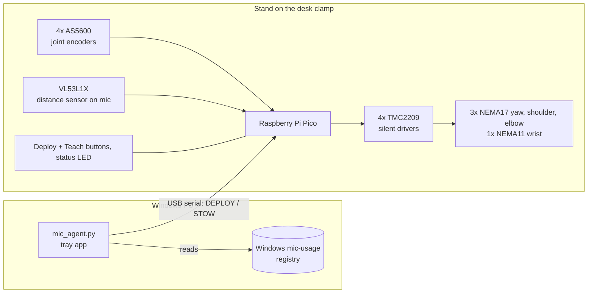

# Auto-deploying desk mic arm

A motorised mic arm that clamps to the front edge of the side desk of an L-shaped desk. When idle it stands **folded up next to its clamp**, with the mic flipped up beside the arm. When any app on your PC opens the microphone, it unfolds, swings in over the front of the main desk and lowers the mic to the spot you taught it. A distance sensor on the mic head then keeps the mic a set distance from your face as you lean. Built for a **Behringer C-1**, and designed for about 1 kg at the tip, including the wrist motor, shock mount and pop filter.

**Design rules, in order:**
1. **Silent.** A condenser mic hears everything.
2. **Light** and simple.
3. **Almost no compute.** A $4 Raspberry Pi Pico, no camera, no AI.
4. **Safe** near your face.

## How it works



1. **Detect.** The PC agent checks Windows' own record of which apps are using the mic (it's what drives the taskbar mic icon). It sends `DEPLOY` the moment one starts, and `STOW` 45 s after the last one stops.
2. **Deploy.** The arm runs a fixed route:
   - **folded** next to the clamp: upper arm up, forearm folded down beside it, mic flipped up
   - **unfold**: one smooth move that turns towards you, raises the forearm and flips the mic down to hanging
   - **100 mm above your spot**
   - **your spot** (the mic drops into place)

   This takes about 7.5 s with the default speed limits.
3. **Track.** The VL53L1X measures the distance to your face. If you sit back or lean in by more than 3 cm for 2 s, the arm moves slowly to restore the distance (default 15 cm). It follows your whole 38 cm lean, and never gets closer than 8 cm.
4. **Teach.** Press Teach and the motors go limp. Drag the mic to where you like it and press Teach again. Absolute encoders on every joint mean the arm never needs to "home".
5. **Stow.** The same route runs backwards. When folded, the motors are braked at zero current: silent, and using almost no power.

**Mechanically:**
- **Arm layout.** A double-parallelogram arm with the yaw, shoulder and elbow motors at the base. The elbow is driven by a push-rod, and the mic head stays level automatically.
- **Wrist.** A small geared NEMA11 at the head flips the mic between hanging (live) and pointing up (folded). A small spring carries most of the mic's weight. Whenever the wrist stands still it brakes at zero current, so it's silent while you're live.
- **Counterbalance.** Springs on Dyneema cords balance the arm against gravity, so small motors are enough.
- **Drive.** GT2 belts with an 18:1 reduction on the arm joints, which are quieter than gears.

## What's in this repo

| Folder | What | Status |
|---|---|---|
| [`sim/`](sim/arm_sim.py) | Geometry, clearance, torque and spring calculator. [`sim/config.json`](sim/config.json) holds the L-desk this design is for. **Run this before CAD** | Working |
| [`firmware/`](firmware/README.md) | Pico firmware (PlatformIO): motion, encoders, tracking, safety | Builds; not yet run on hardware |
| [`pc-agent/`](pc-agent/README.md) | Windows tray app that watches the mic | Working; tested in dry-run |
| [`docs/`](docs/) | [BOM](docs/BOM.md), [assembly](docs/assembly.md), [calibration](docs/calibration.md), [measurement sheet](docs/measurements.md) | Written |
| `cad/` | Printable parts (STEP + STL) | To do: designed from the sim's numbers |
| `electronics/` | Wiring / KiCad | v1 is perfboard per [firmware/README.md](firmware/README.md#wiring) |

## Quick start

```bash
python sim/arm_sim.py
```
That checks the design against the desk in `sim/config.json`. To start from scratch for a different desk, move that file aside and run:
```bash
python sim/arm_sim.py --write-config
```
To try other link lengths:
```bash
python sim/arm_sim.py --sweep
```
To draw the poses (needs `pip install matplotlib`):
```bash
python sim/arm_sim.py --plot
```

## What the sim says about this design

The desk: an L-shaped desk, 80.5 cm high, with walls behind it and along the side desk's far edge. Two monitors are in front of you, with a CRT in the corner. The clamp is 30 cm along the side desk's front edge from the inside corner. Your mouth is 35–73 cm behind the main desk's edge.

| Item | Value |
|---|---|
| Links | **400 + 400 mm**, 90 mm head bracket (room for the flipped-up mic beside the forearm) |
| Drive | **18:1** on the arm (20T→60T, then 16T→96T). Wrist: NEMA11 with a **27:1** gearbox |
| Motor margins | Shoulder 2.2×, elbow 3.3×, yaw 3.7×, wrist 6.2× |
| Motor margin **without springs** | 0.4×, so the springs are essential |
| Springs | Shoulder ≈ 1.12 N/mm, elbow ≈ 0.97 N/mm, up to ~145 N (50/80 mm lever geometry). Wrist: a small spring carrying ~85% of the mic's weight |
| Parked | Folded on the side desk, within ~25 cm of the clamp, about 50 cm tall |
| Deploy time | ~7.5 s |
| Clamp load | 10.1 N·m. Use a clamp rated for 30 N·m or more, which a monitor-arm clamp is |

## Build phases

| # | Phase | Done when |
|---|---|---|
| 0 | Measure: fill in [docs/measurements.md](docs/measurements.md) | Numbers are in `sim/config.json` |
| 1 | Simulate | `arm_sim.py` prints `ALL CHECKS PASS` with your numbers |
| 2 | Order parts ([BOM](docs/BOM.md)); AliExpress takes 2–3 weeks | Ordered |
| 3 | Bench electronics: Pico + 1 driver + 1 motor + 1 encoder | Motor turns silently, encoder follows it |
| 4 | CAD: clamp adapter → turret → shoulder housing → links → wrist head → electronics box | Full assembly in CAD, no clashes |
| 5 | Print and assemble the mechanics (PETG) | Arm moves smoothly by hand, no wobble |
| 6 | Counterbalance ([calibration](docs/calibration.md#3-counterbalance-springs)) | Arm floats at any angle and sinks very slowly; mic hangs by itself |
| 7 | Full electronics, enclosure | All four axes `JOG` |
| 8 | Firmware bring-up ([firmware/README.md](firmware/README.md#first-power-up)) | `soak_test.py` passes 50 cycles |
| 9 | PC agent | Opening the mic in Discord deploys; closing it stows 45 s later |
| 10 | Distance tracking | Lean back 10 cm and the arm follows quietly within ~3 s |
| 11 | Audio QA ([calibration](docs/calibration.md#7-audio-check)) | No audible motor noise, hum or creak at high gain |
| 12 | Polish: cable management, KiCad PCB, covers | Done |

## Safety

- **Speed limits.** No part of the arm moves faster than 150 mm/s within 250 mm of your mouth. The final drop is 75 mm/s and tracking nudges are 50 mm/s.
- **Collision response.** Encoders are checked against commanded positions every 20 ms. More than 3° of error means a collision or bump: the arm goes to FAULT, with motors braked at zero current.
- **Buttons.** Either button stops a moving arm.
- **Power loss.** The springs are tuned slightly under-balanced, so on power loss the arm sinks slowly *away* from your face, and the mic stays hanging.
- **Limits.** Joints are limited in software and by physical hard stops, including the wrist's folded stop.
- **Covers.** Fit printed covers over belts, springs and pinch points, especially at the wrist, which sits near your face.
- **Distance sensor.** The VL53L1X laser is Class 1 (eye-safe).
